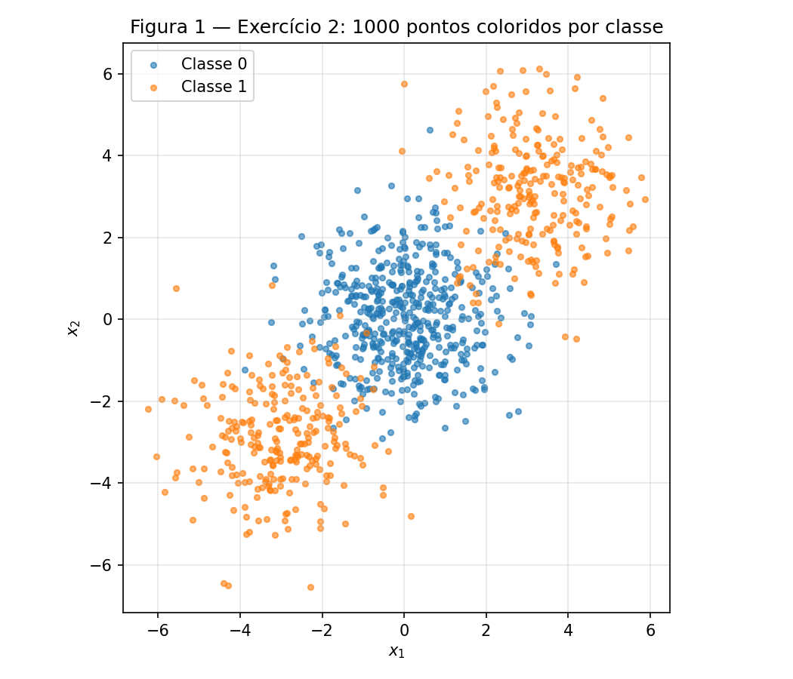
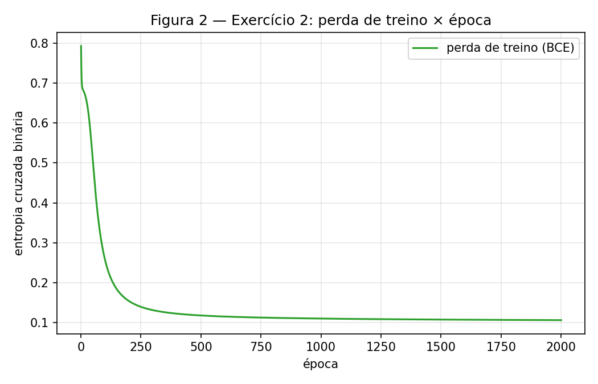
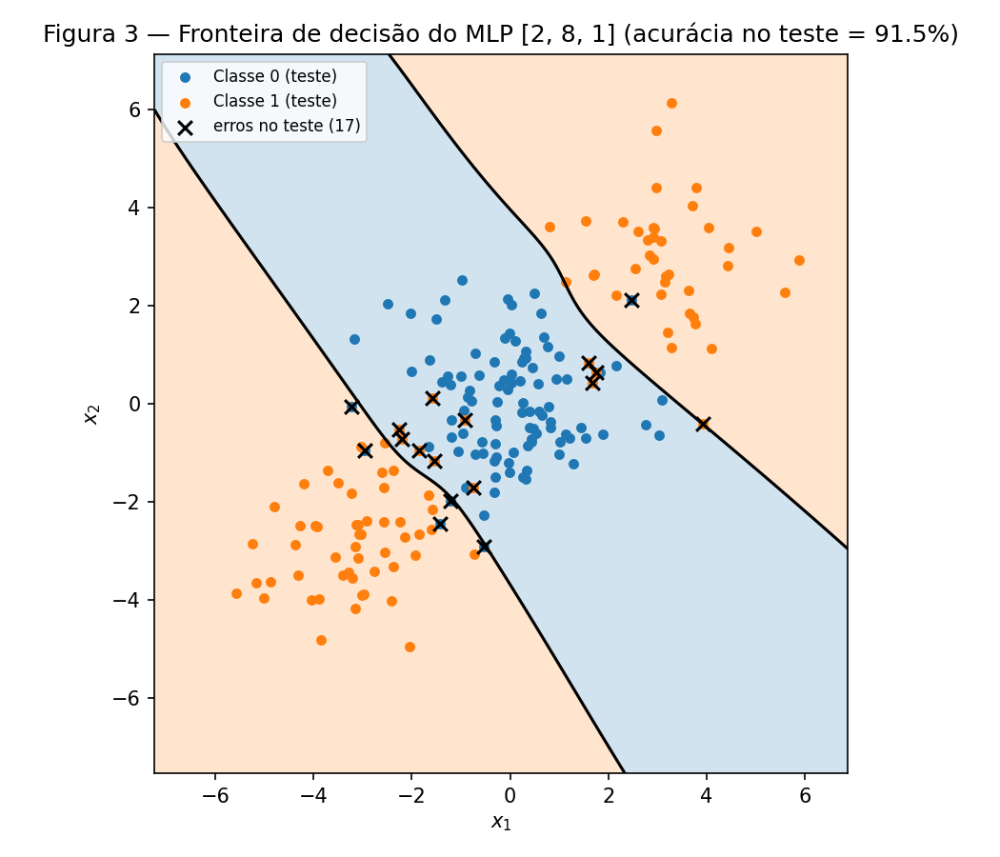
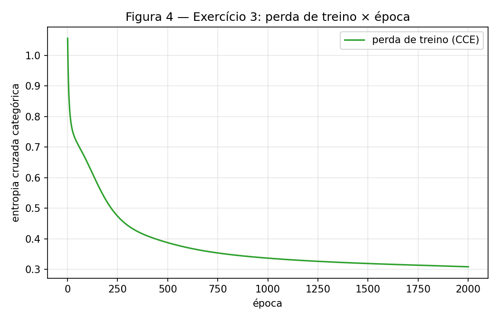
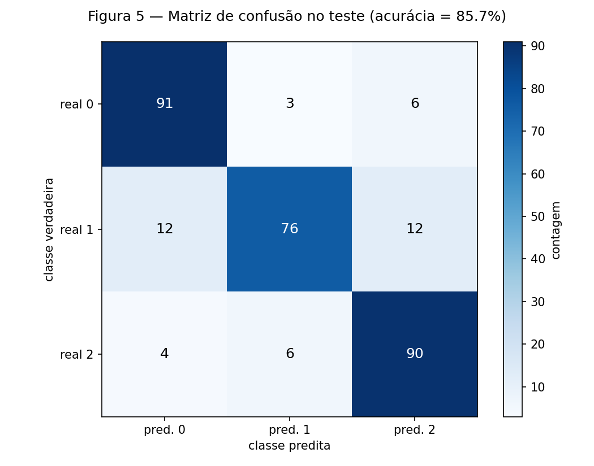
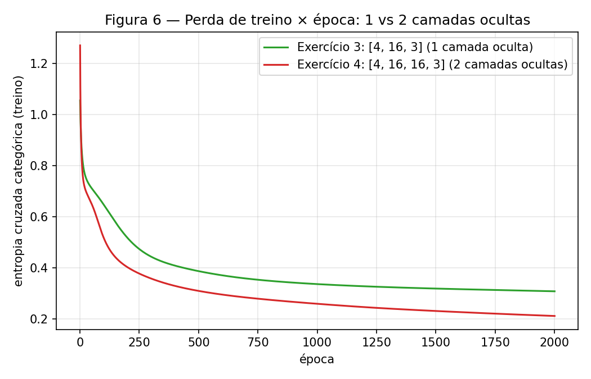

# MLP

!!! info inline end "Exercício"

    MLP — retropropagação na mão, camada oculta e profundidade

    Fontes: [`code/`](https://github.com/carloshernanic/ann-dl/tree/main/docs/exercises/mlp/code) ·
    Figuras: [`figures/`](https://github.com/carloshernanic/ann-dl/tree/main/docs/exercises/mlp/figures)

O fio condutor desta atividade é **o que uma camada oculta compra**: um passo
de retropropagação feito à mão para ver cada parâmetro se mover, depois um
dataset que reta nenhuma resolve, depois mais classes, e por fim a pergunta de
se uma segunda camada oculta compra alguma coisa.

**Abordagem.** Todo o código está em um único notebook executado,
[`code/mlp.ipynb`](code/mlp.ipynb). O MLP é uma classe escrita do zero em
NumPy que recebe os tamanhos das camadas como argumento (`[2, 8, 1]`,
`[4, 16, 3]`, `[4, 16, 16, 3]`): passagem direta, perda, passagem reversa com
cada gradiente derivado à mão e atualização por gradiente descendente em lote
completo. A mesma classe, intocada, é usada nos Exercícios 2, 3 e 4; a saída
(sigmoide + entropia cruzada binária ou softmax + entropia cruzada categórica)
e os hiperparâmetros são argumentos. O scikit-learn entra só onde o enunciado
permite: `make_blobs`, `make_classification`, `train_test_split`, a regressão
logística das linhas de base e `confusion_matrix`. `rng = np.random.default_rng(42)`
é o único gerador usado para inicializar as redes.

!!! note "Código"

    O notebook completo, com todas as células e saídas, está renderizado em
    [`code/mlp.ipynb`](code/mlp.ipynb). Para reproduzir:
    `jupyter nbconvert --to notebook --execute docs/exercises/mlp/code/mlp.ipynb`.
    A classe `MLP` está reproduzida no item C do Exercício 2.

---

## Exercício 1

**Um passo de retropropagação, na mão**

Rede com 2 entradas, 1 camada oculta de 2 neurônios e 1 saída, $\tanh$ nas
duas camadas, perda $L = (y - \hat y)^2$ para uma única amostra. Valores:
$\mathbf{x} = [0.5, -0.2]$, $y = 1.0$,
$\mathbf{W}^{(1)} = \begin{bmatrix} 0.3 & -0.1 \\ 0.2 & 0.4 \end{bmatrix}$,
$\mathbf{b}^{(1)} = [0.1, -0.2]$, $\mathbf{W}^{(2)} = [0.5, -0.3]$,
$b^{(2)} = 0.2$, $\eta = 0.3$. Uso $\frac{d}{du}\tanh(u) = 1 - \tanh^2(u)$.
Todos os números abaixo foram feitos à mão e conferidos na primeira célula do
notebook; reporto 6 casas decimais.

### A — Passagem direta

**Pré-ativações da camada oculta**, $\mathbf{z}^{(1)} = \mathbf{W}^{(1)}\mathbf{x} + \mathbf{b}^{(1)}$:

$$
z^{(1)}_1 = 0.3 \cdot 0.5 + (-0.1)(-0.2) + 0.1 = 0.15 + 0.02 + 0.1 = 0.270000
$$

$$
z^{(1)}_2 = 0.2 \cdot 0.5 + 0.4 \cdot (-0.2) + (-0.2) = 0.10 - 0.08 - 0.2 = -0.180000
$$

**Ativações da camada oculta**, $\mathbf{h}^{(1)} = \tanh(\mathbf{z}^{(1)})$:

$$
h^{(1)}_1 = \tanh(0.27) = 0.263625, \qquad h^{(1)}_2 = \tanh(-0.18) = -0.178081
$$

**Pré-ativação de saída**, $u^{(2)} = \mathbf{W}^{(2)}\mathbf{h}^{(1)} + b^{(2)}$:

$$
u^{(2)} = 0.5 \cdot 0.263625 + (-0.3)(-0.178081) + 0.2 = 0.131813 + 0.053424 + 0.2 = 0.385237
$$

**Saída e perda:**

$$
\hat y = \tanh(0.385237) = 0.367247, \qquad
L = (1 - 0.367247)^2 = 0.632753^2 = 0.400377
$$

### B — Passagem reversa

**Derivada da perda em relação à saída.** De $L = (y - \hat y)^2$:

$$
\frac{\partial L}{\partial \hat y} = -2\,(y - \hat y) = -2 \cdot 0.632753 = -1.265507
$$

**Pré-ativação de saída.** Como $\hat y = \tanh(u^{(2)})$,
$\partial \hat y/\partial u^{(2)} = 1 - \hat y^2 = 1 - 0.134870 = 0.865130$, e pela regra da cadeia

$$
\delta^{(2)} \equiv \frac{\partial L}{\partial u^{(2)}} = \frac{\partial L}{\partial \hat y}\,(1 - \hat y^2) = -1.265507 \cdot 0.865130 = -1.094828
$$

**Camada de saída.** $u^{(2)} = \sum_j W^{(2)}_j h^{(1)}_j + b^{(2)}$, logo
$\partial u^{(2)}/\partial W^{(2)}_j = h^{(1)}_j$ e $\partial u^{(2)}/\partial b^{(2)} = 1$:

$$
\frac{\partial L}{\partial \mathbf{W}^{(2)}} = \delta^{(2)}\,\mathbf{h}^{(1)} = -1.094828 \cdot [0.263625,\ -0.178081] = [-0.288624,\ 0.194968]
$$

$$
\frac{\partial L}{\partial b^{(2)}} = \delta^{(2)} = -1.094828
$$

**Propagação para a camada oculta.** Cada $h^{(1)}_j$ entra em $u^{(2)}$ multiplicado por $W^{(2)}_j$:

$$
\frac{\partial L}{\partial \mathbf{h}^{(1)}} = \delta^{(2)}\,\mathbf{W}^{(2)} = -1.094828 \cdot [0.5,\ -0.3] = [-0.547414,\ 0.328448]
$$

e, com $h^{(1)}_j = \tanh(z^{(1)}_j)$, $\ 1 - (h^{(1)})^2 = [1 - 0.069498,\ 1 - 0.031713] = [0.930502,\ 0.968287]$:

$$
\boldsymbol{\delta}^{(1)} \equiv \frac{\partial L}{\partial \mathbf{z}^{(1)}} = \frac{\partial L}{\partial \mathbf{h}^{(1)}} \odot \left(1 - (\mathbf{h}^{(1)})^2\right)
= [-0.547414 \cdot 0.930502,\ 0.328448 \cdot 0.968287] = [-0.509370,\ 0.318032]
$$

**Camada oculta.** $z^{(1)}_i = \sum_k W^{(1)}_{ik} x_k + b^{(1)}_i$, logo
$\partial L/\partial W^{(1)}_{ik} = \delta^{(1)}_i x_k$ (produto externo) e $\partial L/\partial b^{(1)}_i = \delta^{(1)}_i$:

$$
\frac{\partial L}{\partial \mathbf{W}^{(1)}} = \boldsymbol{\delta}^{(1)} \mathbf{x}^\top =
\begin{bmatrix} -0.509370 \cdot 0.5 & -0.509370 \cdot (-0.2) \\ 0.318032 \cdot 0.5 & 0.318032 \cdot (-0.2) \end{bmatrix} =
\begin{bmatrix} -0.254685 & 0.101874 \\ 0.159016 & -0.063606 \end{bmatrix}
$$

$$
\frac{\partial L}{\partial \mathbf{b}^{(1)}} = \boldsymbol{\delta}^{(1)} = [-0.509370,\ 0.318032]
$$

### C — Atualização dos parâmetros

Com $\eta = 0.3$ e $\theta \leftarrow \theta - \eta\,\partial L/\partial\theta$:

| Parâmetro | Antes | Gradiente | Depois |
|---|---|---|---|
| $W^{(2)}_1$ | 0.5 | −0.288624 | $0.5 + 0.3 \cdot 0.288624 = $ **0.586587** |
| $W^{(2)}_2$ | −0.3 | 0.194968 | $-0.3 - 0.3 \cdot 0.194968 = $ **−0.358490** |
| $b^{(2)}$ | 0.2 | −1.094828 | **0.528448** |
| $W^{(1)}_{11}$ | 0.3 | −0.254685 | **0.376405** |
| $W^{(1)}_{12}$ | −0.1 | 0.101874 | **−0.130562** |
| $W^{(1)}_{21}$ | 0.2 | 0.159016 | **0.152295** |
| $W^{(1)}_{22}$ | 0.4 | −0.063606 | **0.419082** |
| $b^{(1)}_1$ | 0.1 | −0.509370 | **0.252811** |
| $b^{(1)}_2$ | −0.2 | 0.318032 | **−0.295410** |

Ou seja: $\mathbf{W}^{(2)} = [0.586587, -0.358490]$, $b^{(2)} = 0.528448$,
$\mathbf{W}^{(1)} = \begin{bmatrix} 0.376405 & -0.130562 \\ 0.152295 & 0.419082 \end{bmatrix}$,
$\mathbf{b}^{(1)} = [0.252811, -0.295410]$.

**A perda desce numa segunda passagem direta.** O gradiente descendente move
cada parâmetro na direção contrária ao gradiente, e para um passo pequeno o
bastante a perda cai por construção: $L(\theta - \eta\nabla L) \approx L(\theta) - \eta\lVert\nabla L\rVert^2 < L(\theta)$.
Aqui o efeito é visível na saída: todos os termos empurram $u^{(2)}$ para cima
(o bias de saída sobe 0.33, $W^{(2)}_1$ cresce no sentido de $h^{(1)}_1 > 0$, e
$W^{(2)}_2$ fica mais negativo no sentido de $h^{(1)}_2 < 0$), e $\hat y$ sobe em
direção a $y = 1$. Refazendo a passagem direta com os parâmetros novos:
$\hat y = 0.711181$ e $L = 0.083417$, contra $0.400377$ antes. O passo foi
grande ($\eta = 0.3$ com um gradiente de magnitude $\approx 1$), mas ainda
assim dentro da região onde a aproximação linear vale, porque a $\tanh$ satura
e limita o quanto $\hat y$ pode andar.

---

## Exercício 2

**Classificação binária que uma reta não resolve**

### A — Gere os dados

`make_blobs` com os centros $[0,0]$, $[3,3]$ e $[-3,-3]$, 500 + 250 + 250
amostras, `cluster_std=1.2`, `random_state=42`; $y = 1$ para os dois grupos
externos. Divisão 80/20 com `train_test_split(test_size=0.2, random_state=42, stratify=y)`:
800 pontos de treino e 200 de teste, exatamente 50 % de cada classe em ambos.


/// caption
**Figura 1** — Os 1000 pontos coloridos por classe: a classe 0 no centro e a
classe 1 em dois grupos em cantos opostos.
///

### B — Estabeleça a linha de base

Regressão logística do scikit-learn ajustada no treino: **acurácia no teste de
47.50 %**, pior do que chutar. Os coeficientes aprendidos são praticamente nulos
($\mathbf{w} = [0.0296, 0.0015]$, $b = -0.0031$): a reta não encontra direção
nenhuma que ajude. O item D explica.

### C — Implemente o MLP

A classe, tal como está no notebook (usada sem alteração nos Exercícios 3 e 4):

``` python
def tanh(u):
    return np.tanh(u)


def dtanh_from_h(h):
    '''Derivada da tanh escrita em função da própria ativação: 1 - tanh(u)^2.'''
    return 1.0 - h ** 2


def sigmoid(u):
    return 1.0 / (1.0 + np.exp(-u))


def softmax(u):
    e = np.exp(u - u.max(axis=1, keepdims=True))   # estável numericamente
    return e / e.sum(axis=1, keepdims=True)


class MLP:
    '''MLP com tanh nas camadas ocultas e sigmoide/softmax na saída.

    layer_sizes: lista [n_in, n_h1, ..., n_out]  -> qualquer profundidade.
    output:      "sigmoid" (BCE, n_out = 1) ou "softmax" (CCE, n_out = K).
    '''

    def __init__(self, layer_sizes, output="sigmoid", lr=0.1, rng=None):
        self.sizes = list(layer_sizes)
        self.output = output
        self.lr = lr
        # Inicialização: W ~ N(0, 1/n_in) (mantém a escala das pré-ativações), b = 0.
        self.W = [rng.normal(0.0, 1.0 / np.sqrt(n_in), size=(n_in, n_out))
                  for n_in, n_out in zip(self.sizes[:-1], self.sizes[1:])]
        self.b = [np.zeros(n_out) for n_out in self.sizes[1:]]

    def n_params(self):
        return int(sum(W.size + b.size for W, b in zip(self.W, self.b)))

    # ---------------------------------------------------------- passagem direta
    def forward(self, X):
        '''Guarda as ativações de cada camada (h[0] = X) para a passagem reversa.'''
        self.h = [X]
        a = X
        n_layers = len(self.W)
        for l, (W, b) in enumerate(zip(self.W, self.b)):
            u = a @ W + b                                   # pré-ativação
            if l < n_layers - 1:
                a = tanh(u)                                 # camada oculta
            else:
                a = sigmoid(u) if self.output == "sigmoid" else softmax(u)
            self.h.append(a)
        return a

    # ------------------------------------------------------------------- perda
    def loss(self, P, Y):
        eps = 1e-12
        if self.output == "sigmoid":
            return float(-np.mean(Y * np.log(P + eps) + (1 - Y) * np.log(1 - P + eps)))
        return float(-np.mean(np.sum(Y * np.log(P + eps), axis=1)))

    # --------------------------------------------------------- passagem reversa
    def backward(self, Y):
        '''Gradientes de todas as camadas, derivados à mão (sem autodiff).'''
        N = Y.shape[0]
        # dL/du na saída: (p - y)/N, tanto para sigmoide+BCE quanto softmax+CCE.
        delta = (self.h[-1] - Y) / N
        self.dW = [None] * len(self.W)
        self.db = [None] * len(self.b)
        for l in reversed(range(len(self.W))):
            self.dW[l] = self.h[l].T @ delta                # dL/dW^(l) = h^(l-1)^T delta
            self.db[l] = delta.sum(axis=0)                  # dL/db^(l) = soma sobre as amostras
            if l > 0:                                       # propaga para a camada anterior
                delta = (delta @ self.W[l].T) * dtanh_from_h(self.h[l])

    # ------------------------------------------------------------- atualização
    def update(self):
        for l in range(len(self.W)):
            self.W[l] -= self.lr * self.dW[l]
            self.b[l] -= self.lr * self.db[l]

    # ------------------------------------------------------------------ treino
    def fit(self, X, Y, epochs):
        '''Gradiente descendente em lote completo; devolve a perda por época.'''
        history = []
        for _ in range(epochs):
            P = self.forward(X)
            history.append(self.loss(P, Y))
            self.backward(Y)
            self.update()
        return history

    def predict(self, X):
        P = self.forward(X)
        if self.output == "sigmoid":
            return (P[:, 0] >= 0.5).astype(int)
        return P.argmax(axis=1)
```

**As quatro partes, e de onde vêm os gradientes.**

- *Passagem direta.* $\mathbf{h}^{(0)} = \mathbf{X}$ (uma amostra por linha);
  para cada camada $\mathbf{u}^{(l)} = \mathbf{h}^{(l-1)}\mathbf{W}^{(l)} + \mathbf{b}^{(l)}$,
  $\mathbf{h}^{(l)} = \tanh(\mathbf{u}^{(l)})$ nas ocultas e
  $\mathbf{p} = \sigma(\mathbf{u}^{(L)})$ na saída.
- *Perda.* Entropia cruzada binária,
  $L = -\frac{1}{N}\sum_n \left[y_n \log p_n + (1 - y_n)\log(1 - p_n)\right]$.
- *Passagem reversa.* Para uma amostra, $\partial L_n/\partial p_n = -\frac{y_n}{p_n} + \frac{1 - y_n}{1 - p_n}$
  e $\partial p_n/\partial u_n = p_n(1 - p_n)$; o produto simplifica para
  $\partial L_n/\partial u_n = p_n - y_n$, logo
  $\boldsymbol{\delta}^{(L)} = (\mathbf{p} - \mathbf{y})/N$. Daí, camada a
  camada, exatamente como no Exercício 1 mas em forma matricial:
  $\partial L/\partial\mathbf{W}^{(l)} = \mathbf{h}^{(l-1)\top}\boldsymbol{\delta}^{(l)}$,
  $\partial L/\partial\mathbf{b}^{(l)} = \sum_n \boldsymbol{\delta}^{(l)}_n$ e
  $\boldsymbol{\delta}^{(l-1)} = \left(\boldsymbol{\delta}^{(l)}\mathbf{W}^{(l)\top}\right) \odot \left(1 - (\mathbf{h}^{(l-1)})^2\right)$.
- *Atualização.* $\theta \leftarrow \theta - \eta\,\partial L/\partial\theta$ em
  lote completo, uma vez por época.

**Treino.** Arquitetura **[2, 8, 1]** (2 entradas, 8 neurônios $\tanh$, 1 saída
sigmoide; 33 parâmetros), $\eta = 0.3$, **2000 épocas**. Perda final de treino
0.1062; acurácia no treino 96.50 %; **acurácia no teste 91.50 %** (17 erros em
200), dentro da faixa esperada de 90–93 %.


/// caption
**Figura 2** — Perda de treino (entropia cruzada binária) × época.
///


/// caption
**Figura 3** — Fronteira de decisão da rede avaliada em uma grade, com as duas
regiões sombreadas e os pontos de teste por cima; erros marcados com ×.
///

### D — Análise

A linha de base fica abaixo de 50 % por **geometria**, não por azar. A classe 1
está em dois grupos, em $(3, 3)$ e $(-3, -3)$, simétricos em relação à classe 0
na origem. Uma reta $\mathbf{w}\cdot\mathbf{x} + b = 0$ divide o plano em dois
semiplanos; qualquer reta que deixe o grupo de $(3,3)$ do lado "classe 1" deixa
o grupo de $(-3,-3)$ do lado "classe 0", porque os dois estão em direções
opostas a partir do centro. O melhor que uma reta consegue é acertar um grupo
da classe 1 e a metade da classe 0, perdendo o outro grupo: cerca de 50 %. A
regressão logística, que minimiza a perda e não a acurácia, prefere a solução
"neutra" $\mathbf{w} \approx 0$, e o resultado numérico (47.5 %) fica abaixo de
50 % por flutuação da amostra de teste.

A Figura 3 mostra o que a camada oculta compra. A região que a rede atribui à
classe 0 é uma **faixa diagonal** em torno da origem, delimitada por duas
fronteiras quase paralelas (de inclinação $\approx -1$, perpendiculares à reta
que liga os dois grupos da classe 1); a região da classe 1 é o **complemento:
dois semiplanos em cantos opostos**, superior direito e inferior esquerdo.
Nenhuma reta sozinha produz uma faixa: uma reta tem um lado só de cada classe,
e a faixa exige que a classe 1 apareça *dos dois lados* da classe 0. Com 8
neurônios $\tanh$ a rede efetivamente aprende duas retas (duas das unidades
ocultas) e combina os dois sinais na camada de saída, como um "E" lógico:
classe 0 se está acima da reta de baixo *e* abaixo da reta de cima. Os 17 erros
do teste ficam exatamente nas bordas da faixa, onde as nuvens se sobrepõem.

---

## Exercício 3

**Multiclasse, a mesma rede**

### A — Gere os dados

`make_classification(n_samples=1500, n_features=4, n_informative=4, n_redundant=0, n_repeated=0, n_classes=3, n_clusters_per_class=2, class_sep=1.0, random_state=42)`,
divisão 80/20 com `random_state=42` e `stratify=y`: 1200 pontos de treino e 300
de teste, 100 por classe no teste. As 4 features são padronizadas com média e
desvio **do treino**, em NumPy; a linha de base recebe os mesmos dados.

### B — Adapte a rede

Mesma classe `MLP`, mesmo `forward`, `backward` e `update`. O que muda são
argumentos: `layer_sizes=[4, 16, 3]` (3 unidades de saída) e
`output="softmax"`, que seleciona a softmax na saída e a entropia cruzada
categórica em `loss`. Os rótulos viram one-hot.

**Derivação de $\partial L/\partial \mathbf{u}$ para softmax + entropia cruzada.**
Para uma amostra com saída $\mathbf{u} \in \mathbb{R}^K$, $p_k = \dfrac{e^{u_k}}{\sum_j e^{u_j}}$
e $L = -\sum_k y_k \log p_k$, com $\mathbf{y}$ one-hot ($\sum_k y_k = 1$).
Primeiro a derivada da softmax: para $k = i$,
$\partial p_k/\partial u_i = p_i - p_i^2 = p_i(1 - p_i)$; para $k \ne i$,
$\partial p_k/\partial u_i = -p_k p_i$. Em uma linha,
$\partial p_k/\partial u_i = p_k(\delta_{ki} - p_i)$. Então

$$
\frac{\partial L}{\partial u_i} = -\sum_k \frac{y_k}{p_k}\,\frac{\partial p_k}{\partial u_i}
= -\sum_k \frac{y_k}{p_k}\,p_k(\delta_{ki} - p_i)
= -\sum_k y_k\,\delta_{ki} + p_i \sum_k y_k
= p_i - y_i .
$$

O $p_k$ do denominador do $\log$ cancela com o $p_k$ da derivada da softmax, e
a soma $\sum_k y_k = 1$ absorve o resto: o gradiente na pré-ativação de saída é
simplesmente **$\mathbf{p} - \mathbf{y}$**, a mesma forma do caso sigmoide +
BCE. É por isso que `backward` não precisa saber qual saída está em uso: a
linha `delta = (self.h[-1] - Y) / N` vale para as duas, e o resto da
retropropagação é idêntico. Essa é a reutilização literal do item extra.

### C — Treine e avalie

**Linha de base** (regressão logística multinomial nos dados padronizados):
**66.33 %** no teste.

**MLP [4, 16, 3]** (131 parâmetros), $\eta = 0.3$, 2000 épocas: perda final de
treino 0.3084, acurácia no treino 87.92 %, **acurácia no teste 85.67 %**, dentro
da faixa esperada de 83–86 %.


/// caption
**Figura 4** — Perda de treino (entropia cruzada categórica) × época.
///


/// caption
**Figura 5** — Matriz de confusão no conjunto de teste (linhas: classe
verdadeira; colunas: classe predita).
///

### D — Análise

**Par mais confundido.** Somando as duas direções da matriz de confusão, os
pares erram 15 (0–1), 10 (0–2) e **18 (1–2)**. O par mais confundido é
**classes 1 e 2**: 12 pontos da classe 1 viram 2 e 6 da classe 2 viram 1. A
classe 1 é a pior em geral (76 % de acerto, contra 91 % e 90 %), perdendo 12
pontos para cada lado.

**Por que, pela estrutura dos dados.** Cada classe é formada por 2 grupos
gaussianos em $\mathbb{R}^4$, 6 grupos no total, espalhados pelo gerador com
`class_sep=1.0` nos vértices de um hipercubo. Com um k-means de 2 centros por
classe (escrito em NumPy, no treino padronizado) localizei os 6 centros e medi a
menor distância entre um grupo de uma classe e um grupo de outra: 1.70 para
(0, 1), 1.81 para (0, 2) e **1.46 para (1, 2)**. Um dos grupos da classe 1 e um
dos grupos da classe 2 são os vizinhos mais próximos entre todos os pares
entre-classes, e com desvio padrão 1 por dimensão duas gaussianas a 1.46 de
distância se sobrepõem bastante. Além disso, a fronteira que a rede precisa
aprender entre 1 e 2 é a mais retorcida: cada classe tem dois grupos em lados
diferentes do espaço, então separar 1 de 2 exige isolar duas regiões disjuntas
de outras duas, e com só 16 unidades ocultas parte dessa fronteira fica
grosseira. A confusão concentra-se, portanto, onde a geometria coloca grupos
de classes diferentes mais próximos.

**O que a camada oculta acrescentou.** A regressão logística multinomial, com
uma fronteira linear por par de classes, fica em 66.33 %: ela consegue atribuir
a cada classe uma única região convexa, mas cada classe ocupa *dois* grupos, e
um deles acaba sempre do lado errado. O MLP sobe para 85.67 %, quase 20 pontos,
porque as 16 unidades $\tanh$ criam regiões não convexas e disjuntas: cada
classe pode ser "a união de dois pedaços". O que resta de erro é a sobreposição
real entre os grupos, que nenhuma fronteira resolve.

---

## Exercício 4

**Uma segunda camada oculta ajuda?**

### A — Treine a rede mais profunda

Mesmos dados, mesma padronização, mesma semente, mesmo $\eta = 0.3$ e mesmas
2000 épocas. A única mudança é a profundidade: **[4, 16, 16, 3]**, duas camadas
ocultas de 16 unidades (403 parâmetros, contra 131). Resultado com o mesmo `rng`
do relatório: perda final de treino 0.2118, acurácia no treino 92.83 %,
**acurácia no teste 84.33 %**.

### B — Compare


/// caption
**Figura 6** — Perda de treino × época das redes do Exercício 3 (1 camada
oculta) e do Exercício 4 (2 camadas ocultas), nos mesmos eixos.
///

| | camadas ocultas | parâmetros | perda final de treino | acurácia no teste |
|---|---|---|---|---|
| Exercício 3 — [4, 16, 3] | 1 | 131 | 0.3084 | 85.67 % |
| Exercício 4 — [4, 16, 16, 3] | 2 | 403 | 0.2118 | 84.33 % |

**Três sementes de inicialização** (42, 7 e 123; dados e divisão fixos, mesmo
orçamento):

| Semente | Ex. 3: perda / acurácia | Ex. 4: perda / acurácia |
|---|---|---|
| 42 | 0.2971 / 85.33 % | 0.2156 / 84.33 % |
| 7 | 0.2776 / 84.67 % | 0.2070 / 86.67 % |
| 123 | 0.2773 / 84.33 % | 0.2145 / 84.33 % |
| **média** | 0.2840 / **84.78 %** (± 0.42) | 0.2123 / **85.11 %** (± 1.10) |

Diferença média de acurácia (Ex. 4 − Ex. 3): **+0.33 pontos percentuais**, menor
que a variação entre sementes de qualquer um dos dois modelos. Na execução
principal a rede profunda ficou 1.33 pontos *abaixo*; na média de três
sementes, empatou.

### C — Análise

**O que medi.** A segunda camada oculta não comprou acurácia: +0.33 pp na média
de três sementes, com desvio de ±1.1 pp, e −1.33 pp na execução principal. O
que ela comprou foi perda de treino: 0.21 contra 0.28–0.31, consistentemente,
em todas as sementes (Figura 6). Treino e teste contam histórias diferentes, e
isso é a chave.

**Por quê.** Os dados têm 6 grupos gaussianos em 4 dimensões. A fronteira
necessária é "a união de dois pedaços por classe", o que uma camada de 16
unidades $\tanh$ já representa: 16 hiperplanos combinados na saída bastam para
recortar 6 regiões. A segunda camada acrescenta capacidade de representação
(composições de composições, fronteiras mais curvas), mas o problema não pede
isso: a dificuldade restante não é o formato da fronteira e sim a
**sobreposição entre os grupos**, especialmente entre as classes 1 e 2, a 1.46
de distância com desvio 1. Nenhuma fronteira, por mais flexível, separa pontos
que ocupam a mesma região. A capacidade extra é gasta, então, em ajustar a
fronteira aos pontos de treino que caem na zona de sobreposição: a perda de
treino cai (0.21), a acurácia de treino sobe (92.8 % contra 87.9 %), e o teste
não acompanha (84.3 % contra 85.7 %). Isso é o começo de sobreajuste, com três
vezes mais parâmetros para os mesmos 1200 pontos. Do lado da otimização, a
rede profunda com $\tanh$ e gradiente descendente puro também tem gradientes
mais atenuados nas primeiras camadas (dois fatores $1 - h^2 \le 1$ no caminho),
o que a Figura 6 não mostra como problema aqui, mas que é o custo típico quando
a profundidade cresce sem normalização ou otimizadores adaptativos.

**Que dados recompensariam a profundidade.** Dados em que a fronteira
verdadeira é *composicional*: estruturas que se repetem em escalas diferentes
ou que exigem combinar combinações de features. Exemplos: uma classe que é um
anel dentro de um anel (ou um "xadrez" com muitas células), em que a primeira
camada detecta direções e a segunda combina essas detecções em regiões
fechadas; imagens, em que a primeira camada vê bordas e as seguintes vêem
partes e objetos; ou problemas com muitas features em que a interação relevante
é de ordem alta (paridade de vários bits, por exemplo). Nesses casos uma única
camada precisaria de exponencialmente mais unidades para representar a mesma
função, e a profundidade compra eficiência de representação. Seis gaussianas
em quatro dimensões não são um desses casos.

---

## Resumo dos resultados

| # | Quantidade | Valor |
|---|---|---|
| 1 | Ex. 1 — $\mathbf{z}^{(1)}$ e $\mathbf{h}^{(1)}$ | $\mathbf{z}^{(1)} = [0.270000, -0.180000]$, $\mathbf{h}^{(1)} = [0.263625, -0.178081]$ |
| 2 | Ex. 1 — $u^{(2)}$, $\hat y$ e $L$ | $u^{(2)} = 0.385237$, $\hat y = 0.367247$, $L = 0.400377$ |
| 3 | Ex. 1 — os oito parâmetros atualizados | $\mathbf{W}^{(2)} = [0.586587, -0.358490]$, $b^{(2)} = 0.528448$, $\mathbf{W}^{(1)} = [[0.376405, -0.130562], [0.152295, 0.419082]]$, $\mathbf{b}^{(1)} = [0.252811, -0.295410]$ |
| 4 | Ex. 2 — acurácia da linha de base linear | 47.50 % |
| 5 | Ex. 2 — arquitetura e acurácia no teste | [2, 8, 1], $\eta = 0.3$, 2000 épocas: 91.50 % |
| 6 | Ex. 3 — arquitetura e acurácia no teste | [4, 16, 3], $\eta = 0.3$, 2000 épocas: 85.67 % (linha de base 66.33 %) |
| 7 | Ex. 3 — par de classes mais confundido | classes 1 e 2 (18 erros: 12 de 1→2 e 6 de 2→1) |
| 8 | Ex. 4 — arquitetura e acurácia no teste | [4, 16, 16, 3], mesmos $\eta$ e épocas: 84.33 % (média de 3 sementes: 85.11 %) |
| 9 | Ex. 4 — diferença de acurácia em relação ao Ex. 3 (média de ≥ 3 sementes) | +0.33 pp (85.11 % − 84.78 %), dentro do ruído de ±1.1 pp; −1.33 pp na execução principal |
