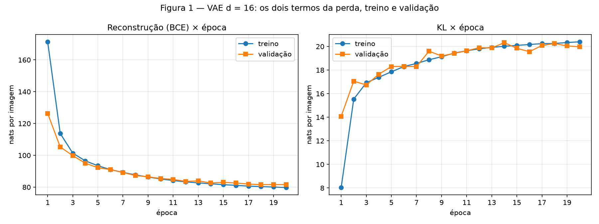
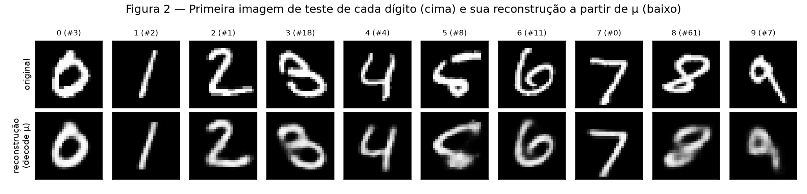
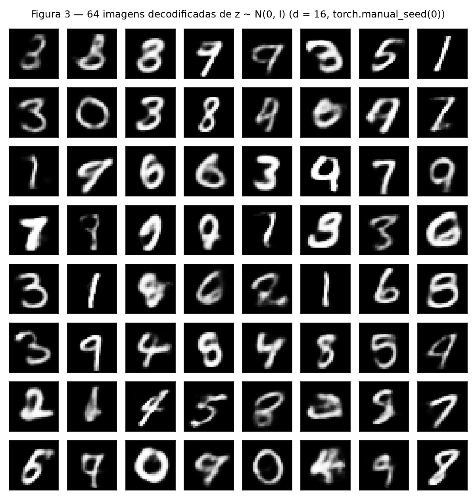
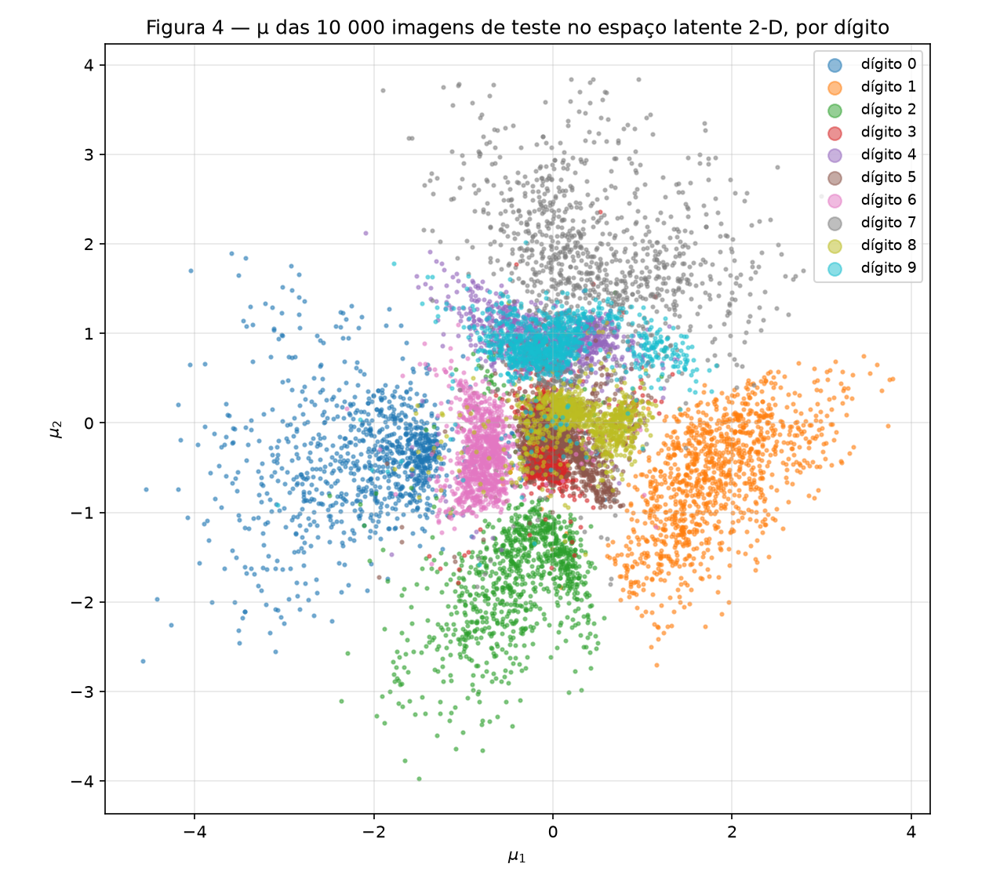
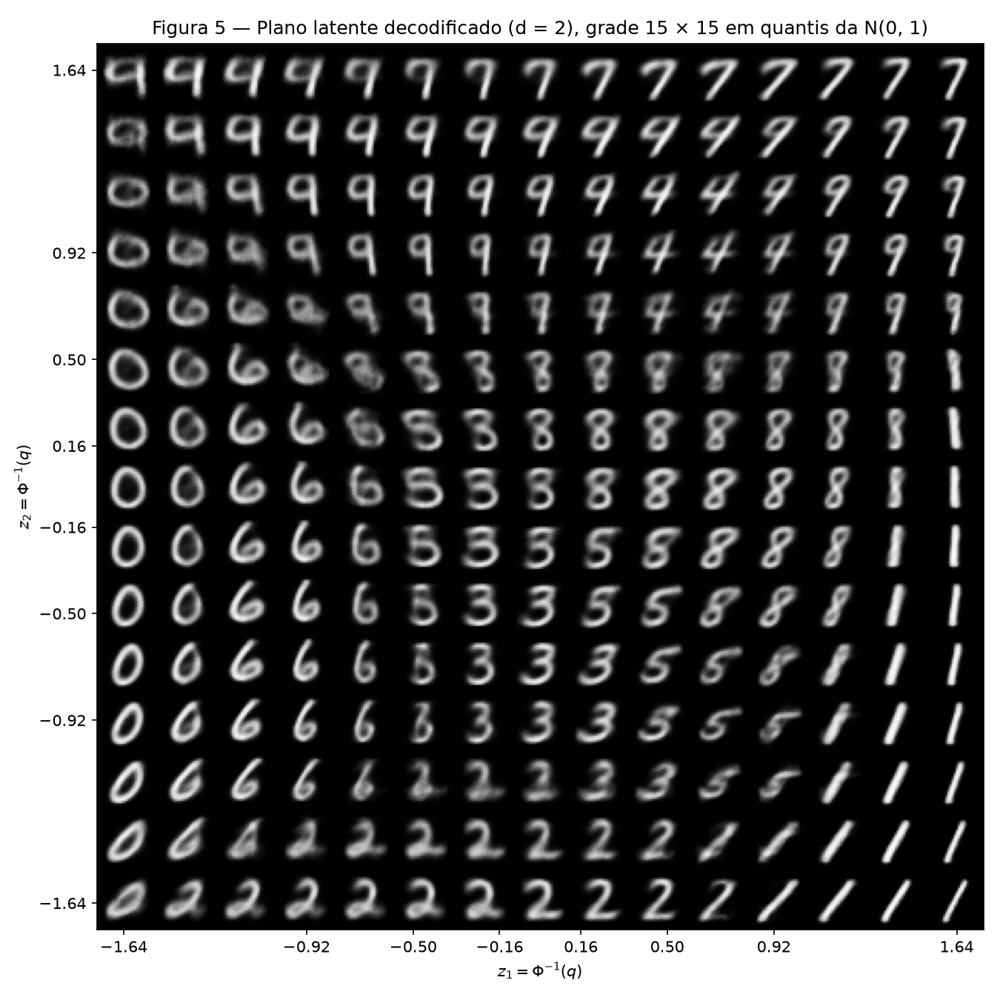
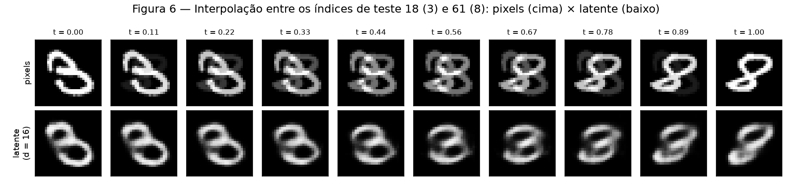

# VAE

!!! info inline end "Exercício"

    VAE — o cabo de guerra dentro da perda

    Fontes: [`code/`](https://github.com/carloshernanic/ann-dl/tree/main/docs/exercises/vae/code) ·
    Figuras: [`figures/`](https://github.com/carloshernanic/ann-dl/tree/main/docs/exercises/vae/figures)

O fio condutor desta atividade é **o cabo de guerra dentro da perda**: um VAE
paga ao mesmo tempo para reconstruir a entrada e para manter o espaço latente
perto de um prior do qual se sabe amostrar. Primeiro um VAE no MNIST com
$d = 16$, registrando os dois termos separadamente; depois um espaço latente
2-D que dá para enxergar, para ver o que esse prior compra e quanto custa.

**Abordagem.** Todo o código está em um único notebook executado,
[`code/vae.ipynb`](code/vae.ipynb), rodado na CPU com `torch` 2.14. As
partes próprias do VAE são escritas à mão: a reparametrização, a BCE somada
sobre os 784 pixels, a KL em forma fechada por extenso e a amostragem; o
autograd e o Adam ficam por conta do `torch`. Os dois termos são sempre
reportados **separadamente, em nats por imagem**. O conjunto de teste só é
avaliado ao final de cada modelo; todas as curvas de acompanhamento usam a
validação. Sementes: `torch.manual_seed(42)` antes de construir cada modelo,
`torch.Generator().manual_seed(42)` na divisão treino/validação e na ordem dos
lotes, `torch.manual_seed(0)` para as amostras do prior.

!!! note "Código"

    O notebook completo, com todas as células e saídas (inclusive o log das 20
    épocas de cada modelo), está renderizado em [`code/vae.ipynb`](code/vae.ipynb).
    Para reproduzir: `jupyter nbconvert --to notebook --execute docs/exercises/vae/code/vae.ipynb`
    (baixa o MNIST para `data/mnist/` na raiz do repositório). O modelo e a
    perda estão reproduzidos no item B abaixo.

---

## Exercício 1

**Um VAE no MNIST**

### A — Carregue e divida os dados

MNIST do `torchvision` com `transforms.ToTensor()` (pixels em $[0, 1]$),
achatado em vetores de 784. As 60 000 imagens de treino foram divididas com
`random_split(train_full, [50_000, 10_000], generator=torch.Generator().manual_seed(42))`
em **50 000 de treino e 10 000 de validação**; as 10 000 imagens oficiais de
teste são o conjunto de teste. Os três conjuntos ficam em memória como tensores
`(N, 784)`. Um dado que justifica a verossimilhança de Bernoulli do item B:
81.5 % dos pixels do treino valem exatamente 0 ou 1.

### B — Construa o modelo

Arquitetura do enunciado: encoder $784 \to 512 \to 256$ com ReLU, duas cabeças
lineares $256 \to d$ para $\boldsymbol\mu$ e $\log\boldsymbol\sigma^2$, decoder
$d \to 256 \to 512 \to 784$ com ReLU nas ocultas e sigmoide na saída;
$d = 16$ (1 079 600 parâmetros). A classe e a perda, tal como estão no notebook:

``` python
class VAE(nn.Module):
    '''VAE totalmente conectado para MNIST achatado (784), com latente de dimensão d.'''

    def __init__(self, d):
        super().__init__()
        self.d = d
        self.encoder = nn.Sequential(
            nn.Linear(784, 512), nn.ReLU(),
            nn.Linear(512, 256), nn.ReLU(),
        )
        self.head_mu = nn.Linear(256, d)          # cabeça para mu
        self.head_logvar = nn.Linear(256, d)      # cabeça para log sigma^2
        self.decoder = nn.Sequential(
            nn.Linear(d, 256), nn.ReLU(),
            nn.Linear(256, 512), nn.ReLU(),
            nn.Linear(512, 784), nn.Sigmoid(),    # cada pixel: probabilidade de estar "aceso"
        )

    def encode(self, x):
        h = self.encoder(x)
        return self.head_mu(h), self.head_logvar(h)

    def reparameterize(self, mu, logvar):
        '''z = mu + sigma * eps, eps ~ N(0, I). O ruído entra como constante, o
        gradiente flui por mu e por sigma — é isso que torna o amostrador treinável.'''
        sigma = torch.exp(0.5 * logvar)
        eps = torch.randn_like(sigma)
        return mu + sigma * eps

    def decode(self, z):
        return self.decoder(z)

    def forward(self, x):
        mu, logvar = self.encode(x)
        z = self.reparameterize(mu, logvar)
        return self.decode(z), mu, logvar


def vae_loss_terms(x_hat, x, mu, logvar):
    '''Devolve (reconstrução, KL), ambos em nats POR IMAGEM:
    somados sobre os 784 pixels / d dimensões latentes, média sobre o lote.'''
    n = x.size(0)
    recon = F.binary_cross_entropy(x_hat, x, reduction="sum") / n
    # KL( N(mu, sigma^2) || N(0, 1) ) em forma fechada, dimensão a dimensão:
    #   1/2 * (mu^2 + sigma^2 - 1 - log sigma^2)
    kl = 0.5 * torch.sum(mu.pow(2) + logvar.exp() - 1.0 - logvar) / n
    return recon, kl
```

As três peças que o enunciado exige à mão:

- **Reparametrização.** $\mathbf{z} = \boldsymbol\mu + \boldsymbol\sigma \odot \boldsymbol\epsilon$,
  $\boldsymbol\epsilon \sim \mathcal{N}(0, I)$, com $\boldsymbol\sigma = \exp(\tfrac12\log\boldsymbol\sigma^2)$.
  O ruído é uma constante para o autograd; o gradiente da perda chega a
  $\boldsymbol\mu$ e a $\log\boldsymbol\sigma^2$ através de $\mathbf{z}$.
- **Reconstrução.** $-\sum_{j=1}^{784}\left[x_j\log\hat x_j + (1 - x_j)\log(1 - \hat x_j)\right]$,
  com `reduction="sum"` dividido pelo tamanho do lote: a BCE de uma imagem é a
  soma sobre os pixels, e o número reportado é a média dessas somas. É a
  verossimilhança de Bernoulli, que combina com uma saída sigmoide e com pixels
  quase todos 0 ou 1.
- **KL em forma fechada.** $\tfrac12\sum_{i=1}^{d}\left(\mu_i^2 + \sigma_i^2 - 1 - \log\sigma_i^2\right)$,
  escrita por extenso a partir de $\log\sigma_i^2$ (sem `torch.distributions`),
  somada sobre as $d$ dimensões e com média sobre o lote.
- **Perda.** $L = \text{BCE} + \beta\,\text{KL}$ com $\beta = 1$.

### C — Treine

Adam, $10^{-3}$, lotes de 128, 20 épocas. A cada época registrei a
reconstrução e a KL do treino (média ao longo da época) e da validação; o
notebook mostra o log completo. No **teste** ($d = 16$):

| Termo | Teste, nats por imagem |
|---|---|
| Reconstrução (BCE) | **80.95** |
| KL | **19.99** |
| Soma (ELBO negativo) | **100.95** |

dentro da referência do enunciado (≈ 81 e 20). Na validação, a KL foi de
**14.08 na primeira época** a **19.97 na última** (máximo de 20.33 na época 14);
no treino, de 8.03 a 20.40. A reconstrução de validação caiu de 126.40 para
81.59. Cada modelo levou cerca de 4 minutos na CPU.


/// caption
**Figura 1** — Reconstrução × época (esquerda) e KL × época (direita), treino e
validação, para o VAE com $d = 16$. A KL sobe enquanto a reconstrução cai.
///

### D — Reconstruções e amostras


/// caption
**Figura 2** — Primeira imagem de teste de cada dígito de 0 a 9 (índices de
teste 3, 2, 1, 18, 4, 8, 11, 0, 61 e 7) em cima e sua reconstrução em baixo,
obtida decodificando $\boldsymbol\mu$, sem amostrar $\mathbf{z}$.
///


/// caption
**Figura 3** — Grade $8 \times 8$ de imagens decodificadas de
$\mathbf{z} \sim \mathcal{N}(0, I_{16})$, sorteadas após `torch.manual_seed(0)`.
///

### E — Análise

**1. Por que a KL sobe enquanto a perda total cai.** No início do treino o
encoder ainda não aprendeu a codificar nada: $\boldsymbol\mu \approx 0$,
$\boldsymbol\sigma \approx 1$, a KL é pequena (8 nats no treino da primeira
época) e a reconstrução é péssima (171 nats). A KL é o preço de colocar
informação em $\mathbf{z}$: afastar $\boldsymbol\mu$ da origem e encolher
$\boldsymbol\sigma$ custa $\tfrac12(\mu^2 + \sigma^2 - 1 - \log\sigma^2)$ por
dimensão, mas é exatamente isso que permite ao decoder saber qual imagem
reconstruir. Enquanto um nat extra de KL compra mais de um nat de redução na
BCE, o gradiente da perda total aponta para "pagar mais KL". Foi o que
aconteceu: entre a época 1 e a 20 a KL de validação subiu 6 nats e a
reconstrução caiu 45. O equilíbrio chega quando a troca fica de um para um,
por volta de 20 nats de KL. É a visão taxa-distorção do ELBO: a KL é a taxa (quantos
nats de informação sobre $\mathbf{x}$ passam pelo gargalo) e a BCE é a
distorção; o otimizador sobe a taxa até o ponto em que ela deixa de valer a
pena. A conferência numérica do notebook mostra onde essa informação ficou: 12
das 16 dimensões latentes têm KL entre 0.8 e 2.4 nats e as outras 4 têm KL zero
($\sigma = 1$, $\mu = 0$), ou seja, o modelo decidiu que 12 canais bastam.

**2. Por que a Figura 3 parece pior que a Figura 2.** Duas razões distintas.

*Onde as amostras do prior caem.* A KL puxa cada posterior $q(\mathbf{z}\mid\mathbf{x})$
para perto de $\mathcal{N}(0, I)$, mas não garante que a *mistura* de todos os
posteriores (o posterior agregado) seja a normal padrão. No teste, as
codificações têm $\lVert\boldsymbol\mu\rVert \approx 3.3$ com $\sigma$ entre
0.1 e 0.4 nas dimensões usadas: são ilhas estreitas, com buracos entre elas, e
4 dimensões em que o encoder não escreve nada. Uma amostra do prior, com norma
≈ 4 em 16 dimensões, cai com frequência num buraco entre as ilhas ou numa
direção que o decoder nunca viu durante o treino. Nesses pontos o decoder
extrapola, e o resultado são as imagens que não são dígito nenhum (os borrões
da linha 5 e 7 da Figura 3). As reconstruções da Figura 2 partem de
$\boldsymbol\mu$ de uma imagem real, que por construção está no centro de uma
ilha.

*O que o decoder produz para um dado $\mathbf{z}$.* A saída do decoder é a
média de uma Bernoulli por pixel: a probabilidade de cada pixel estar aceso,
dado $\mathbf{z}$. Com a BCE, o decoder é treinado para produzir, para cada
$\mathbf{z}$, a *média* de todas as imagens cujo posterior cobre aquele ponto.
Como $\sigma > 0$, cada $\mathbf{z}$ é alcançado a partir de várias imagens
vizinhas, e a média de vários "8" ligeiramente diferentes é um "8" borrado. Isso
vale para qualquer ponto do espaço latente, mas é mais visível num $\mathbf{z}$
do prior, que fica entre modos e recebe a média de imagens de estilos ou mesmo
de dígitos diferentes. O borrão é uma propriedade da verossimilhança escolhida,
não um defeito de treino: a média de uma Bernoulli é o melhor que a BCE pode
pedir.

**3. Por que decodificar $\boldsymbol\mu$ e não um $\mathbf{z}$ amostrado.**
$\boldsymbol\mu$ é o centro do posterior $q(\mathbf{z}\mid\mathbf{x})$, o ponto
mais provável e o que o encoder "quis dizer" sobre a imagem; decodificá-lo dá a
reconstrução determinística e reproduzível que mede o que o modelo capturou. Um
$\mathbf{z}$ amostrado acrescenta $\boldsymbol\sigma \odot \boldsymbol\epsilon$
e desloca a reconstrução para uma imagem vizinha, de modo que a figura mudaria a
cada execução e misturaria duas coisas que queremos separar: o que o encoder
codificou e o ruído do amostrador. Durante o treino a amostragem é necessária
(é ela que faz o decoder aprender a ser robusto numa vizinhança e que dá sentido
à KL); na hora de olhar reconstruções, não.

---

## Exercício 2

**Um espaço latente que dá para ver**

### A — Treine um VAE 2-D

Mesmo modelo, dados, semente, $\beta = 1$ e orçamento (Adam $10^{-3}$, lotes de
128, 20 épocas); só $d$ mudou de 16 para 2 (1 068 820 parâmetros). No teste:

| Teste, nats por imagem | $d = 16$ | $d = 2$ |
|---|---|---|
| Reconstrução (BCE) | 80.95 | **134.49** |
| KL | 19.99 | **6.66** |
| ELBO negativo | 100.95 | **141.15** |

dentro da referência (≈ 135 e 7). Com dois números por imagem a KL cai para um
terço e a reconstrução piora 53 nats. A KL de validação foi de 4.82 na
primeira época a 6.66 na última.

### B — O conjunto de teste codificado


/// caption
**Figura 4** — $\boldsymbol\mu$ das 10 000 imagens de teste no plano latente do
VAE com $d = 2$, uma cor por dígito.
///

### C — O plano decodificado


/// caption
**Figura 5** — Grade $15 \times 15$ de pontos latentes $z = \Phi^{-1}(q)$, com
$q$ em 15 valores igualmente espaçados em $[0.05, 0.95]$, decodificada pelo VAE
com $d = 2$ e disposta no mesmo arranjo ($z_1$ cresce para a direita, $z_2$
para cima).
///

Os 15 valores de $z$ vão de $-1.64$ a $1.64$, mais densos perto de zero
(0.16 entre os centrais, 0.44 entre os extremos). **Por que esse espaçamento dá
a cada célula a mesma massa do prior:** $\Phi$ é a CDF da $\mathcal{N}(0, 1)$,
então passos iguais de $q$ são passos iguais de probabilidade acumulada, e cada
intervalo entre dois $z$ consecutivos carrega a mesma massa $1/15$ do prior em
cada eixo; uma grade linear em $z$ gastaria metade das células nas caudas, onde
quase nenhuma imagem é codificada.

### D — Interpolação

Imagens de teste escolhidas: **índice 18** (dígito 3) e **índice 61** (dígito
8), as mesmas da Figura 2. Dez valores de $t$ de 0 a 1.


/// caption
**Figura 6** — Linha de cima: interpolação no espaço dos pixels,
$(1 - t)\,\mathbf{x}_a + t\,\mathbf{x}_b$. Linha de baixo: interpolação no
espaço latente do modelo $d = 16$ do Exercício 1, decodificando
$(1 - t)\,\boldsymbol\mu_a + t\,\boldsymbol\mu_b$.
///

### E — Análise

**1. Quais dígitos se sobrepõem.** Na Figura 4 as sobreposições são duas. A
mais forte é **4 e 9**: os centros das duas nuvens distam 0.12 no plano
latente e, atribuindo cada ponto de teste ao centro de dígito mais próximo,
498 dos 1009 noves caem no centro do 4; o 7 fica logo acima dos dois. A
segunda é o aglomerado **3, 5 e 8** em torno da origem (centros a 0.19 e 0.30
um do outro), com o 6 encostado à esquerda. Os dígitos isolados são 0 (à
esquerda), 1 (à direita), 2 (embaixo) e 7 (em cima). Na Figura 5 as mesmas
transições aparecem no mesmo lugar: a faixa superior do plano
($z_2 \approx 0.9$) é toda 9 e 4, e nas colunas centrais ($z_1$ entre 0.16 e
0.92) as imagens do meio do caminho são um 9 cujo laço superior vai se abrindo
até virar a forquilha do 4, um híbrido que não é claramente nenhum dos dois. No
meio do plano ($z_2$ entre $-0.16$ e 0.16) a linha passa por 6, 3, 5, 8 e 1,
e entre o 3 e o 8 ou o 5 e o 8 os quadros intermediários são um 3 com os laços
se fechando ou um 5 com a barriga de um 8, borrados onde as duas formas se
misturam. É a transição 3→8 que a Figura 6 percorre em $d = 16$.

**2. O que dois números por imagem obrigam o modelo a jogar fora.** Com
$d = 2$ a KL de teste é 6.66 nats: é toda a informação que passa pelo gargalo
sobre cada imagem, contra 19.99 nats em $d = 16$. Seis nats e meio dão para
dizer *qual* dígito é (cerca de $\log 10 = 2.3$ nats) e um ou dois atributos
contínuos de estilo, e nada mais. A Figura 5 mostra o que sobrou: ao longo de
cada região o decoder só varia inclinação e largura (os 1 vão de inclinados a
retos ao longo da coluna da direita, os 9 e 7 ficam mais ou menos abertos), e
todas as imagens são protótipos lisos do dígito. Espessura do traço, o laço
particular de um 2, a cauda do 5 da Figura 2, a abertura exata de um 4: tudo
isso não cabe nos dois números e é substituído pela média da região. O custo
aparece na reconstrução, 134.49 contra 80.95 nats, e na confusão entre dígitos
que $d = 16$ separa sem dificuldade: no plano, 4 e 9 (e 3, 5, 8) disputam o
mesmo lugar porque as dimensões que os distinguiriam foram descartadas.

**3. As duas linhas da Figura 6.** A linha de baixo, no espaço latente,
passa por imagens que parecem dígitos: um 3 que vai ganhando o laço esquerdo
até fechar num 8, com cada quadro sendo uma forma única e plausível (borrada no
meio do caminho, pelas razões do item 1E.2, mas ainda um traço contínuo). A
linha de cima, no espaço dos pixels, não passa por dígito nenhum: do segundo ao
nono quadro vemos o 3 e o 8 *superpostos*, um fantasma cinza do 8 por cima de
um 3 que desvanece. A razão é que a média de dois vetores de pixels é a média
das intensidades, pixel a pixel, e o conjunto de imagens de dígitos não é
convexo no espaço dos pixels: o ponto médio entre dois dígitos é uma dupla
exposição, não um terceiro dígito. O decoder, em contrapartida, mapeia *todo*
ponto do espaço latente para uma imagem do tipo que viu no treino; o segmento
entre $\boldsymbol\mu_a$ e $\boldsymbol\mu_b$ atravessa a região onde o encoder
colocou os 3, os 8 e o que há entre eles, e cada ponto dele é decodificado como
uma forma inteira. Isso é o que o prior comprou: um espaço em que caminhar em
linha reta é passar por imagens plausíveis.

---

## Resumo dos resultados

| # | Quantidade | Valor |
|---|---|---|
| 1 | Ex. 1 — reconstrução, KL e ELBO negativo no teste ($d = 16$) | 80.95, 19.99 e 100.95 nats por imagem |
| 2 | Ex. 1 — KL de validação na primeira e na última época | 14.08 e 19.97 nats por imagem |
| 3 | Ex. 2 — reconstrução e KL no teste ($d = 2$) | 134.49 e 6.66 nats por imagem (ELBO negativo 141.15) |
| 4 | Ex. 2 — os dois índices de teste interpolados | 18 (dígito 3) e 61 (dígito 8) |
